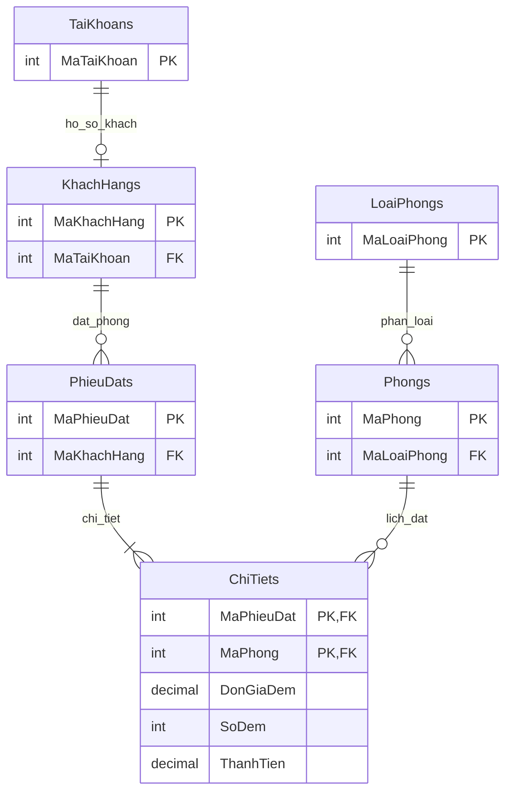

# Thiết kế cơ sở dữ liệu

DbContext: `Data/HotelDbContext.cs`; cấu hình SQL Server ở Program.cs; migration InitialHotel được sinh từ EF Core 10.0.13 và đã áp dụng SQL Server thật.

| Bảng | PK | FK / ràng buộc |
|---|---|---|
| TaiKhoans | MaTaiKhoan int identity | TenDangNhap unique nvarchar(50), hash MatKhau, Email(150), VaiTro enum, TrangThai bool |
| LoaiPhongs | MaLoaiPhong int identity | TenLoaiPhong unique(80), SoNguoiToiDa > 0, DonGiaDem > 0 |
| Phongs | MaPhong int identity | SoPhong unique(20); MaLoaiPhong → LoaiPhongs; Tang >= 0; trạng thái 0..2 |
| KhachHangs | MaKhachHang int identity | MaTaiKhoan → TaiKhoans unique; CCCD12, điện thoại10; NgaySinh nullable cho hồ sơ mới |
| PhieuDats | MaPhieuDat int identity | MaKhachHang → KhachHangs; NgayTraDuKien > NgayNhanDuKien; tổng > 0; trạng thái 0..4 |
| ChiTiets | (MaPhieuDat, MaPhong) | FK đến PhieuDats và Phongs; đơn giá >0, số đêm >0, thành tiền = đơn giá × đêm |

Tất cả tiền decimal(18,2), không dùng double. EF ánh xạ DateTime → datetime2, bool → bit, enum → int, chuỗi Unicode. Đầy đủ thuộc tính tối thiểu của đề nằm trong 6 Entity tương ứng tại Models. Ngày đăng ký/đặt theo giờ Việt Nam, ngày nhận/trả chỉ có phần ngày.

Tài khoản khách có một hồ sơ; admin không có hồ sơ khách nên phía TaiKhoan là 0..1. KháchHang bắt buộc một TaiKhoan, unique FK thực thi quan hệ 1-1. Tạo khách qua quản lý tài khoản sẽ tạo đồng thời hồ sơ. PhieuDat–Phong là n-n qua ChiTiet, composite key ngăn một phòng lặp trong cùng phiếu.

Restrict khi xóa TaiKhoan, LoaiPhong, KhachHang và Phong có tham chiếu. ChiTiet cascade khi xóa phiếu ở tầng DB; UI không cung cấp xóa phiếu nhằm giữ lịch sử. Không đổi số/loại phòng có lịch sử. Giá phòng được thay đổi cho lượt đặt tương lai; phiếu cũ giữ snapshot giá và tổng.

Kiểm tra trùng: `startA < endB && endA > startB`. Chờ xác nhận, đã xác nhận và đã nhận giữ lịch; hủy/đã trả được giải phóng. Giao dịch ReadCommitted có khóa SQL Server `sp_getapplock` Exclusive, Transaction owner, resource chung `Nhom6.Hotel.Inventory`, timeout 15s. Mọi mutation tồn phòng/quản trị liên quan dùng HotelTransaction. Khóa có hiệu lực cả nhiều process dùng cùng DB; SaveChanges/commit nằm trong khóa; dispose rollback nếu lỗi. SQL trực tiếp chỉ lấy khóa nghiệp vụ, CRUD dùng EF/LINQ. Cơ chế ưu tiên tính đúng cho quy mô bài tập, serialize toàn bộ mutation nên chưa tối ưu throughput cao.

Dashboard dùng giao dịch đọc Serializable để các báo cáo cùng snapshot logic; các aggregate xử lý SQL qua LINQ. Top loại sắp xếp số lượt giảm dần, hiển thị toàn bộ để thấy các trường hợp đồng hạng. Doanh thu chỉ phiếu đã trả, lấy tháng của NgayTraDuKien vì schema đề chưa có ngày trả thực tế.

Validation: Required/StringLength/Range/EmailAddress/RegularExpression/EnumDataType, TienAttribute tối đa 2 chữ số thập phân. Hồ sơ dùng HoSoForm và ngày sinh trong 120 năm qua. CCCD đúng 12 chữ số, điện thoại 10 chữ số bắt đầu 0 (kiểm tra định dạng, không xác minh danh tính ngoài hệ thống). Mô tả/địa chỉ có giới hạn chiều dài; Razor encode chuỗi chống chèn HTML.
